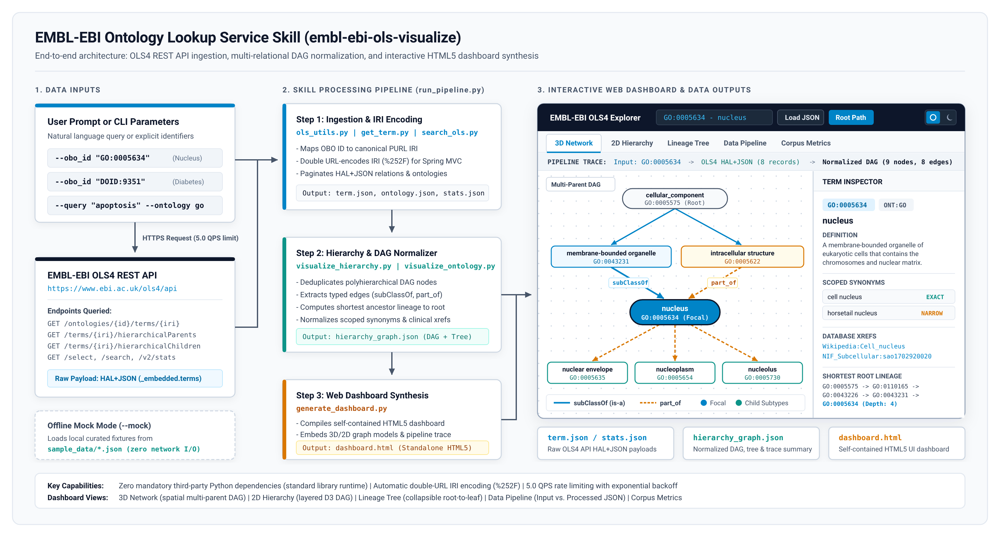

# EMBL-EBI Ontology Lookup Service (OLS) Visualize (`embl-ebi-ols-visualize`)

## 1. Overview

`embl-ebi-ols-visualize` is an Agent Skill for querying, traversing, and visualizing biomedical ontologies hosted by the European Bioinformatics Institute (EMBL-EBI) Ontology Lookup Service (OLS4) REST API (`https://www.ebi.ac.uk/ols4/api`). The service indexes more than 250 biomedical ontologies, including the Gene Ontology (`GO`), Human Disease Ontology (`DOID`), Human Phenotype Ontology (`HP`), Mondo Disease Ontology (`MONDO`), Chemical Entities of Biological Interest (`CHEBI`), Cell Ontology (`CL`), Uber-anatomy Ontology (`UBERON`), Experimental Factor Ontology (`EFO`), and NCI Thesaurus (`NCIT`).



### Technical Capabilities
Biomedical ontologies are structured as multi-relational Directed Acyclic Graphs (DAGs) with multiple inheritance. Inspecting raw nested JSON responses makes it difficult to separate direct taxonomic specialization (`subClassOf` / `is-a`) from structural or developmental relationships (`part_of`, `develops_from`, `derives_from`, `occurs_in`, `regulates`). `embl-ebi-ols-visualize` addresses this by providing:
- Rate-limited, protocol-compliant CLI utilities enforcing the EMBL-EBI 5.0 QPS rate limit, exponential backoff retries, automatic OBO ID to canonical IRI mapping, and double URL-encoding.
- Automated graph and hierarchical tree normalization with shortest-path-to-root tracing, input-to-output data pipeline metrics, and semantic edge classification.
- A standalone, self-contained HTML5 interactive dashboard (`dashboard.html`) featuring five synchronized views (`3D Network`, `2D Hierarchy`, `Lineage Tree`, `Data Pipeline`, and `Corpus Metrics`), a split-pane term inspector for scoped synonyms and clinical cross-references (MeSH, ICD-10, OMIM, UMLS, MedDRA), client-side JSON loading, and a Light/Dark theme switcher.
- A deterministic offline mock engine (`--mock`) backed by synthetic fixtures in `sample_data/` for isolated execution and continuous integration testing without external network access.

---

## 2. Project Structure

All paths in this repository are organized relative to the project root directory:

```text
.
├── .licenses/
│   └── embl_ebi_ols_visualize_LICENSE.txt
├── LICENSE
├── README.md
├── SKILL.md
├── SKILL_LICENSES.md
├── assets/
│   ├── dashboard_schema.json
│   ├── dashboard_template.html
│   ├── skill_overview.png
│   └── skill_overview.svg
├── dashboard.html
├── documents/
│   └── prd.md
├── references/
│   ├── api_reference.md
│   ├── citation.bib
│   └── dashboard_schema.md
├── requirements.txt
├── sample_data/
│   ├── doid_9351_diabetes.json
│   ├── go_0005634_nucleus.json
│   ├── go_0006915_apoptosis.json
│   ├── ontology_go.json
│   ├── search_diabetes.json
│   └── stats.json
├── scripts/
│   ├── generate_dashboard.py
│   ├── get_individual.py
│   ├── get_ontology.py
│   ├── get_property.py
│   ├── get_stats.py
│   ├── get_term.py
│   ├── ols_utils.py
│   ├── run_pipeline.py
│   ├── search_ols.py
│   ├── suggest_ols.py
│   ├── visualize_hierarchy.py
│   └── visualize_ontology.py
├── skills/
│   └── embl_ebi_ols_visualize/
│       ├── LICENSE
│       ├── SKILL.md
│       ├── assets/
│       ├── dashboard.html
│       ├── references/
│       ├── sample_data/
│       └── scripts/
└── tests/
    ├── __init__.py
    ├── test_cli_endpoints.py
    ├── test_system_pipeline.py
    ├── test_unit_ols_utils.py
    └── test_unit_visualizers.py
```

---

## 3. Prerequisites

### System and Runtime Requirements
- **Operating System**: Linux, macOS, or Windows (POSIX-compatible shell recommended).
- **Python Version**: Python 3.10 or higher.
- **Core Runtime Dependencies**: Zero mandatory third-party runtime packages; all HTTP transport, rate limiting, JSON parsing, and HTML synthesis operate using the Python standard library (`urllib`, `json`, `argparse`, `pathlib`, `time`, `logging`).
- **Optional & Testing Dependencies**:
  - `polite-http` (optional HTTP client wrapper; automatic fallback to `urllib.request` is built into `scripts/ols_utils.py`).
  - `pytest>=7.4.0` (for executing the automated unit, CLI smoke, and system test suite).

### Virtual Environment Setup
Run the following commands from the project root directory to configure an isolated Python virtual environment:

```bash
python3 -m venv .venv
source .venv/bin/activate
pip install --upgrade pip
pip install -r requirements.txt
```

---

## 4. Command-Line Execution

### 4.1 Running the Unified End-to-End Pipeline (`scripts/run_pipeline.py`)

The unified pipeline verifies the workspace license guard (`.licenses/embl_ebi_ols_visualize_LICENSE.txt`), resolves search queries or OBO identifiers, fetches hierarchical relations, normalizes the DAG and tree payloads, and compiles `dashboard.html`.

```bash
# 1. Offline Mock Execution (No network connection required)
python3 scripts/run_pipeline.py \
    --obo_id "GO:0005634" \
    --mock \
    -o ./output/mock_nucleus/

# 2. Full Term Hierarchy Profiling by OBO ID (Live API)
python3 scripts/run_pipeline.py \
    --obo_id "GO:0005634" \
    -o ./output/nucleus/

# 3. Disease Term Profiling with Custom Relation Selection
python3 scripts/run_pipeline.py \
    --obo_id "DOID:9351" \
    --relations parents,children,ancestors \
    -o ./output/diabetes/

# 4. Keyword Search with Automatic Entity Resolution
python3 scripts/run_pipeline.py \
    --query "apoptosis" \
    --ontology go \
    -o ./output/apoptosis/

# 5. Ontology Overview and Global Repository Statistics
python3 scripts/run_pipeline.py \
    --ontology go \
    --stats \
    -o ./output/go_overview/
```

All scripts are also mirrored under `skills/embl_ebi_ols_visualize/scripts/` for multi-skill repository layouts:
```bash
python3 skills/embl_ebi_ols_visualize/scripts/run_pipeline.py \
    --obo_id "GO:0005634" \
    --mock \
    -o ./output/mock_nucleus/
```

### 4.2 Running Individual Modular Scripts

```bash
# Full-text search across ontologies
python3 scripts/search_ols.py --query "diabetes" --rows 5 --mock --output ./output/search.json

# Prefix autocomplete suggestions
python3 scripts/suggest_ols.py --query "diabet" --rows 5 --mock --output ./output/suggest.json

# Fetch term metadata and hierarchical relations
python3 scripts/get_term.py --obo_id "GO:0005634" --relations parents,children,ancestors --mock --output ./output/term.json

# Fetch object property details
python3 scripts/get_property.py --obo_id "BFO:0000050" --ontology ro --mock --output ./output/property.json

# Fetch individual instance details
python3 scripts/get_individual.py --obo_id "RO:0001901" --ontology ro --mock --output ./output/individual.json

# Fetch ontology metadata and root classes
python3 scripts/get_ontology.py --ontology go --mock --output ./output/ontology.json

# Fetch global OLS4 repository statistics
python3 scripts/get_stats.py --mock --output ./output/stats.json

# Transform term JSON into normalized DAG and collapsible tree JSON
python3 scripts/visualize_hierarchy.py --term_json ./output/term.json -o ./output/hierarchy_graph.json

# Profile ontology metadata and repository statistics
python3 scripts/visualize_ontology.py --ontology_json ./output/ontology.json --stats_json ./output/stats.json -o ./output/ontology_profile.json

# Compile standalone interactive HTML5 dashboard
python3 scripts/generate_dashboard.py \
    --term_json ./output/term.json \
    --graph_json ./output/hierarchy_graph.json \
    --ontology_json ./output/ontology.json \
    --stats_json ./output/stats.json \
    -o ./output/dashboard.html
```

### 4.3 Running the Automated Test Suite

Execute the unit, CLI smoke, and end-to-end system test suite from the project root directory:

```bash
pytest -v
```

Alternatively, run the test suite via Python's built-in `unittest` discovery runner:

```bash
python3 -m unittest discover -s tests -p "test_*.py" -v
```

---

## 5. Non-Technical User Guide

This section explains how biomedical researchers, clinicians, geneticists, and disease curators can use `embl-ebi-ols-visualize` through natural language prompts without writing code or memorizing command-line flags.

### Step 1: Register the Skill
Place the skill directory (`./` or `skills/embl_ebi_ols_visualize`) in your agent workspace skills directory. The agent reads `SKILL.md` automatically and registers `embl-ebi-ols-visualize`.

### Step 2: Ask Questions in Plain Language
Describe the biological concept, cellular component, phenotype, or disease you want to explore. You can provide either a common medical/scientific name (such as `"diabetes"` or `"programmed cell death"`) or a standard ontology identifier (such as `GO:0005634` or `DOID:9351`).

#### Real-World Example 1: Exploring Cellular Structure in the Gene Ontology
- **What You Ask**:
  > "Show me where the cell nucleus fits in the Gene Ontology hierarchy, and separate what it is a subtype of from the sub-structures contained inside it."
- **What Happens Behind the Scenes**:
  The skill looks up `nucleus (GO:0005634)` in the Gene Ontology, retrieves its parent and child terms, and builds an interactive diagram (`dashboard.html`).
- **What You See**:
  1. A plain-language summary with the official definition of the cell nucleus, its broader categories (`intracellular membrane-bounded organelle` and `intracellular anatomical structure`), and its internal components (`nuclear envelope`, `nucleoplasm`, `nucleolus`, `nuclear pore`, `nuclear lumen`).
  2. An interactive diagram where solid blue arrows show direct classification (`is-a`) and dashed orange arrows show structural containment (`part_of`).

#### Real-World Example 2: Reviewing Disease Classifications and Clinical Codes
- **What You Ask**:
  > "Look up diabetes mellitus in the Human Disease Ontology. List its parent disease categories, clinical subtypes, alternate names, and matching codes in ICD-10, MeSH, and OMIM."
- **What Happens Behind the Scenes**:
  The skill resolves `diabetes mellitus (DOID:9351)`, retrieves its disease hierarchy, and extracts all curated clinical cross-references.
- **What You See**:
  1. A visual disease tree showing how `diabetes mellitus` inherits from both `glucose metabolism disease (DOID:4194)` and `endocrine system disease (DOID:28)`, branching down into `type 1 diabetes mellitus`, `type 2 diabetes mellitus`, and `gestational diabetes`.
  2. In the right-hand Term Inspector panel, a list of recognized synonyms and clickable cross-reference links to clinical databases (`ICD10CM:E08-E13`, `MeSH:D003920`, `OMIM:222100`, `UMLS_CUI:C0011849`, `MedDRA:10012601`).

#### Real-World Example 3: Searching by Biological Keyword
- **What You Ask**:
  > "Find the official Gene Ontology term for apoptosis and trace its lineage back to the top-level biological process root."
- **What Happens Behind the Scenes**:
  The skill searches the Gene Ontology for `"apoptosis"`, matches it to the official term `apoptotic process (GO:0006915)`, and calculates the shortest path to the root of the ontology.
- **What You See**:
  1. Confirmation that `"apoptosis"` maps to `apoptotic process (GO:0006915)`.
  2. A step-by-step lineage path (`biological_process -> cellular process -> cell death -> programmed cell death -> apoptotic process`) that can be expanded or collapsed in the `Lineage Tree` tab.

### Step 3: Using the Interactive Dashboard (`dashboard.html`)
Open `dashboard.html` in any web browser or preview pane to explore the results interactively:
- **Switch Between Five Views**:
  - `3D Network`: Rotate, pan, and zoom through a 3D spatial diagram that separates multi-parent branches across vertical depth layers.
  - `2D Hierarchy`: View a flat top-to-bottom flowchart where individual boxes can be dragged to rearrange the layout.
  - `Lineage Tree`: Click any branch node to expand or collapse child subtypes.
  - `Data Pipeline`: Review the exact query parameters sent to EMBL-EBI alongside the processed nodes and relationships.
  - `Corpus Metrics`: View summary counts of relationship types and overall ontology statistics.
- **Inspect Term Details**: Click any node in the diagram to display its definition, synonyms, parent/child links, and clinical database cross-references in the right-hand sidebar.
- **Highlight the Main Lineage**: Click `Root Path` in the top bar to highlight the shortest chain of parent terms leading from the ontology root to your selected term.
- **Search Within the Diagram**: Type a word or ID into `Filter nodes by label or ID...` to highlight matching terms immediately.
- **Switch Datasets or Load Custom Files**: Use the top dropdown menu to switch between bundled examples, or click `Load JSON` to open any saved output file from `./output/`.
- **Switch Light and Dark Themes**: Click the sun or moon button in the top-right corner to switch between light and dark display modes.

---

## 6. Academic Citations and Disclaimer

- **Primary OLS4 Publication**: McLaughlin, J., Lagrimas, J., Iqbal, H., Parkinson, H. & Harmse, H. *OLS4: a new Ontology Lookup Service for a growing interdisciplinary knowledge ecosystem.* Bioinformatics 41(5), btaf279 (2025). doi:10.1093/bioinformatics/btaf279.
- **Foundational OLS Publication**: Jupp, S., Burdett, T., Leroy, C. & Parkinson, H. E. *A new Ontology Lookup Service at EMBL-EBI.* SWAT4LS, 118-119 (2015).
- **Scientific & Clinical Disclaimer**: Ontology classifications, hierarchical structures, and cross-references reflect curated biomedical models and automated inferences from participating consortiums, and must be independently verified for clinical diagnostic or medical treatment decisions.
